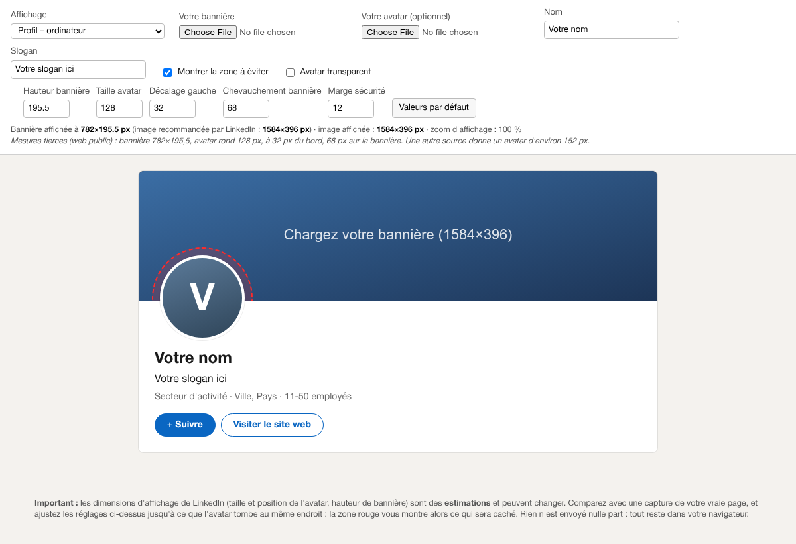

# LinkedIn Banner Preview

Un outil web pour **prévisualiser une bannière LinkedIn** avant de la publier : voyez où l'avatar ou le logo recouvre votre image, sur une page entreprise ou un profil, sur ordinateur ou mobile.



## Fonctionnalités

- 4 modes : page entreprise et profil, chacun en version ordinateur et mobile
- Chargement de votre bannière et de votre avatar (optionnel) depuis votre disque
- Zone de sécurité en rouge autour de l'avatar : ce qu'il ne faut pas y placer
- Avatar transparent pour voir ce qu'il cache
- Nom et slogan modifiables
- Réglages fins (hauteur de bannière, taille et position de l'avatar, marge) avec retour aux valeurs par défaut
- Avertissement si les proportions de votre image diffèrent du format recommandé
- Un seul fichier HTML, sans dépendance, sans build

## Utilisation

Ouvrez `index.html` dans votre navigateur, ou utilisez la version en ligne si elle est publiée via GitHub Pages.

**Vos images ne quittent jamais votre navigateur** : rien n'est envoyé nulle part.

Des paramètres d'URL permettent de partager une configuration :

```
index.html?mode=page-mobile&zone=1&ghost=1
```

| Paramètre | Valeurs |
|---|---|
| `mode` | `page-desktop`, `page-mobile`, `profil-desktop`, `profil-mobile` |
| `zone` | `1` pour afficher la zone à éviter |
| `ghost` | `1` pour rendre l'avatar transparent |

## Formats recommandés

| Type | Taille de l'image |
|---|---|
| Page entreprise | 1512 × 256 px |
| Profil | 1584 × 396 px |

## ⚠ Précision des mesures

LinkedIn **ne publie pas** les dimensions d'affichage exactes (avatar, hauteur de bannière). Les presets viennent de mesures publiées par des tiers et d'une mesure sur l'app mobile. Ils sont **approximatifs** et peuvent changer sans préavis. Chaque preset indique sa source et son niveau de fiabilité dans l'outil.

Comparez avec une capture de votre vraie page et ajustez les réglages. Les corrections de mesures sont bienvenues.

## Contribuer

Les issues et pull requests sont bienvenues, en particulier pour affiner les presets (avec une source ou une capture).

## Licence

[MIT](LICENSE)
