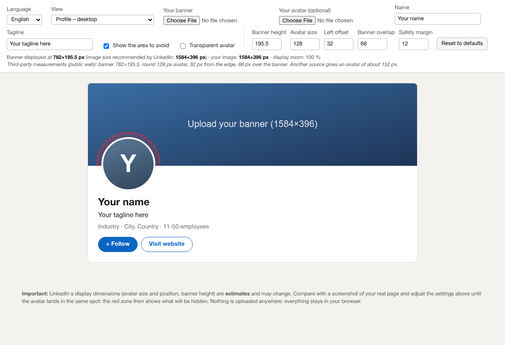
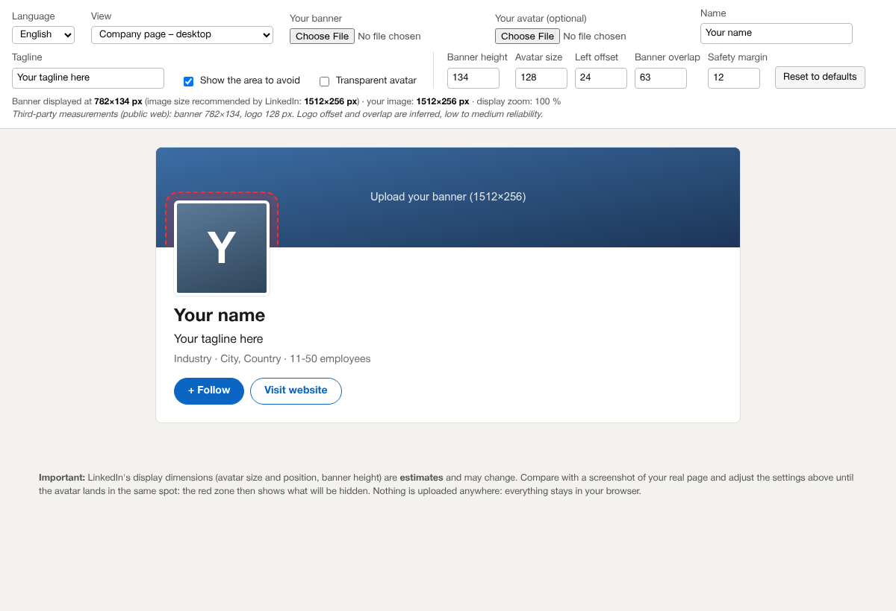

# LinkedIn Banner Preview

A web tool to **preview your LinkedIn banner** before publishing it: see where the avatar or logo covers your image, on desktop or mobile.

It works for **both personal profile banners and company page banners**: pick the matching view in the tool and it applies the right dimensions and avatar shape (round for profiles, rounded square for company logos).

| Personal profile                                      | Company page                                      |
| ----------------------------------------------------- | ------------------------------------------------- |
|  |  |

## Features

- 4 views: **personal profile** and **company page**, each on desktop and mobile
- Load your own banner and avatar (optional) from disk
- Red safe zone around the avatar: what not to put there
- Transparent avatar to see what it hides
- Editable name and tagline
- Available in English and French, with a language switch (auto-detected from your browser, or `?lang=fr`)
- Fine-tuning (banner height, avatar size and position, margin) with reset to defaults
- Warning when your image proportions differ from the recommended format
- A single HTML file: no dependencies, no build

## Usage

Use the hosted version if published via GitHub Pages, or build the tool yourself (see [Development](#development)): `npm run build` produces `dist/index.html`, a **standalone file** you can open by double-clicking it, no server needed.

The sources in `index.html` and `src/` use ES modules, which browsers refuse to load from `file://`. Use `npm run dev` while working on them.

**Your images never leave your browser**: nothing is uploaded anywhere.

URL parameters let you share a configuration:

```
?mode=page-mobile&zone=1&ghost=1
```

| Parameter | Values                                                           |
| --------- | ---------------------------------------------------------------- |
| `mode`    | `page-desktop`, `page-mobile`, `profil-desktop`, `profil-mobile` |
| `zone`    | `1` to show the area to avoid                                    |
| `ghost`   | `1` to make the avatar transparent                               |
| `lang`    | `en` or `fr`                                                     |

## Adding a language

1. Copy `src/i18n/en.js` to `src/i18n/xx.js` and translate the values (keep the keys and the `{placeholders}`).
2. Register it in `src/i18n/index.js`.
3. Add an `<option>` to the `#lang` select in `index.html`.

A test checks that every language defines exactly the same keys as English. Pull requests for new languages are welcome.

## Recommended sizes

| Type             | Image size    | Avatar shape          |
| ---------------- | ------------- | --------------------- |
| Personal profile | 1584 × 396 px | Round                 |
| Company page     | 1512 × 256 px | Rounded square (logo) |

## ⚠ Measurement accuracy

LinkedIn **does not publish** its exact display dimensions (avatar, banner height). The presets come from third-party published measurements and one measurement on the mobile app. They are **approximate** and may change without notice. Each preset states its source and reliability in the tool.

Compare with a screenshot of your real page and adjust the settings. Measurement corrections are welcome.

## Development

Requires Node.js 20 or later.

```sh
npm install
npm run dev      # dev server with hot reload
npm test         # unit tests (Vitest)
npm run lint     # ESLint
npm run format   # Prettier
npm run build    # standalone dist/index.html
```

```
index.html         page markup
src/main.js        DOM wiring and rendering
src/geometry.js    pure layout computations (unit tested)
src/presets.js     display presets and recommended sizes
src/i18n/          translations (en, fr) and language detection
src/styles.css     styles
tests/             unit tests
```

CI runs lint, format check, tests and build on every pull request.

## Contributing

Issues and pull requests are welcome, especially to refine the presets (with a source or a screenshot).

## License

[MIT](LICENSE)
